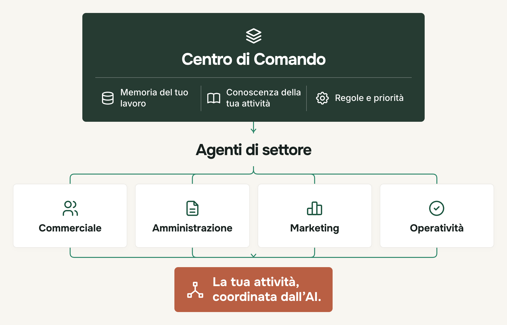

# Ecosistema AI

Un primo lavoro completato e verificato con gli agenti della tua AI. Materiali gratuiti di Sal Chiarenza / LeaderAI.

## Per te, una riga

Incolla questa frase in Claude Code, nella cartella del tuo lavoro:

```text
Scarica questo documento in un file temporaneo e leggilo integralmente dal file, incluse tutte le schede di esempio e le prove: https://raw.githubusercontent.com/salChiarenza/ecosistema-ai-gratuito/main/ISTRUZIONI.md. Usa il testo completo, senza sostituirlo con un riassunto o un’anteprima. Poi completa un lavoro che ripeto con gli agenti necessari, coordinandoli e verificando il risultato. Parti dai miei materiali; chiedimi solo ciò che manca.
```

## Istruzioni per la tua AI

Leggi [la mini guida completa](ISTRUZIONI.md): contiene il percorso, le schede di esempio e le prove sul risultato. Parti dai materiali che la persona ti autorizza a usare. Crea soltanto gli specialisti necessari, esegui il lavoro e controlla ciò che consegnano.

Se il primo lavoro da affidare all’AI è ancora da scegliere, usa la [Mappatura AI](mappatura/README.md). Nella sola chat sono disponibili anche [i sei prompt in testo](mappatura/PROMPTS.md). Nel percorso completo con schede e subagenti serve Claude Code; la guida spiega come riconoscere l’ambiente disponibile.

## La mappa

<picture>
  <source media="(max-width: 640px)" srcset="immagini/mappa-telefono.png">
  
</picture>

## Cosa trovi

- [Mini guida agli agenti di Anthropic](ISTRUZIONI.md): cinque passi, agenti di esempio e prove su casi fittizi prima del lavoro reale.
- [Mappatura AI](mappatura/README.md): tre percorsi già esistenti, per Claude, per ChatGPT/Codex e per lavorare nella chat con sei prompt. Gli HTML si aprono sul computer dopo aver scaricato ed estratto lo [ZIP](https://github.com/salChiarenza/ecosistema-ai-gratuito/archive/refs/heads/main.zip).
- [Lavoro leggero — beta 0.1.0-beta.1](lavoro-leggero/SKILL.md): affida a Haiku le letture e le operazioni semplici in Claude Code, senza il report del Tutor settimanale. Beta per macOS/Linux; [scarica lo ZIP](https://raw.githubusercontent.com/salChiarenza/ecosistema-ai-gratuito/main/lavoro-leggero/lavoro-leggero-0.1.0-beta.1.zip).
- [Mappa dell’Ecosistema](immagini/mappa.png), anche [nel formato per telefono](immagini/mappa-telefono.png).

## Fonti e utilizzo

La mini guida è un adattamento pratico di LeaderAI: le fonti ufficiali di Anthropic sono collegate nei singoli passi. La Mappatura conserva i permessi d’uso riportati nel proprio [README](mappatura/README.md). I contenuti esterni collegati restano dei rispettivi titolari.

[Sal Chiarenza — LeaderAI](https://salchiarenza.ai/)
